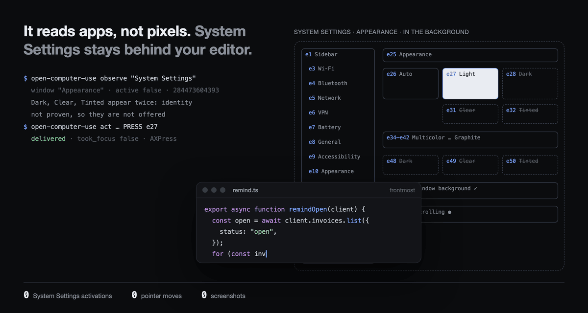

# open-computer-use ⌘

**Agents use your Mac's apps in the background, while you keep using yours.**
No screenshots, no pointer, no app brought to the front.



<sub>Replayed from one real <code>observe</code> and <code>act</code> on System Settings › Appearance. Indices, labels, states and results are the tool's own output; the window geometry is drawn. The run predates the <code>--machine-wide</code> gate below.</sub>

Most computer-use agents look at the screen and move the mouse, so the Mac is theirs while they work. open-computer-use reads an app through the macOS accessibility tree instead, turns it into a numbered table of the controls the app actually exposes, and acts on one of them through a native bridge that never activates the app.

| Problem | What happens here |
| --- | --- |
| The agent needs your screen and your pointer | Observation is the accessibility tree; execution is `AXPress`, `AXValue` and keys addressed to the app's process. No screenshot, mouse event or activation path exists in the bridge |
| The UI moved between looking and clicking | A target is a reference from one observation, bound to the process instance and re-identified against a fresh census before any input |
| A retry presses the button twice | Each decision executes at most once. Delivery is recorded before the result is read, and an uncertain delivery stops instead of replaying |
| "Done" is only the model's opinion | Acceptance is the requested result read back from the app, plus an independent record of zero app activations for the whole task |
| Passwords end up in logs | Secure fields are classified before any value is read; their values are omitted and typed input is redacted from history |

## How it fits together

```text
 the app, left in the background
   │ accessibility tree             ▲ AXPress · AXValue · keys to its pid
   ▼                                │
 observe ──► indexed table ──► guarded act ──► observe again
                   │                ▲
                   ▼                │
   decision: one operation on one observed target
   ├─ a coding agent:     open-computer-use observe / act
   └─ the built-in Agent: one model request per step
```

`axbridge` (Swift) does both ends: it reads the tree and executes the guarded operation.

Requires macOS, Python 3.11+, [uv](https://docs.astral.sh/uv/), the Swift toolchain (Xcode Command Line Tools), and Accessibility permission for the app that launches the bridge (your terminal, or the agent's host app). Screen Recording is not used.

## Drive it from a coding agent

Claude Code, Codex or any agent with a shell can be the decision model itself. No model backend or API key is involved, and the CLI has no Python runtime dependencies.

```sh
git clone https://github.com/max1874/open-computer-use.git
open-computer-use/install.sh
```

`install.sh` is idempotent. It compiles the bridge, installs `open-computer-use` as an editable uv tool (a `git pull` is the update) and copies [the skill](skill/open-computer-use/SKILL.md) into `~/.claude/skills` and `~/.codex/skills` when they exist. Then enable the agent's host app under System Settings › Privacy & Security › Accessibility and check:

```console
$ open-computer-use status
{"accessibility": true, "frontmost": "Otty", "frontmost_pid": 2544, "locked": false}
```

The loop is observe, act, read back:

```console
$ open -g -a TextEdit note.txt              # launch without bringing it forward
$ open-computer-use observe TextEdit
{"app": "TextEdit", "window": "note.txt", "active": false, "fingerprint": "9ff54a0e5b69", "controls": [...]}
{"index": "e1", "role": "TextArea", "operations": ["TYPE_TEXT", "PASTE_TEXT", "KEY_CHORD", "SELECT_TEXT"], "value": "draft\n", "selection": [0, 0]}
...
$ open-computer-use act TextEdit 9ff54a0e5b69 TYPE_TEXT e1 --text '后台写入，没抢焦点。'
{"operation": "TYPE_TEXT", "label": "TextArea", "outcome": "delivered", "delivery": "delivered_verified", "verified": true, "took_focus": false, "mechanism": "AXValue", ...}
{"app": "TextEdit", "window": "note.txt", "active": false, "fingerprint": "a8330d0065a4", ...}
```

`act` starts a fresh bridge, observes again and sends nothing unless the fingerprint still matches the observation the operation was chosen from. It then executes through the same guards and prints the outcome followed by the next observation. Text goes in with `--text`, keys with `--key`, selections with `--start` and `--length`; `observe --text` adds the window's visible text.

Exit codes: `0` delivered, `1` refused or stale (nothing sent), `2` uncertain or unconfirmed delivery (read the window, never resend blind), `3` `focus_violation` (the app came forward: stop). None of them establishes that the whole task succeeded.

## Or give the built-in agent a goal

One app, one natural-language goal. Each step is one model request that chooses the operation, its observed target, any text to enter and a risk rating.

```sh
uv sync --extra agent
uv run --extra agent --env-file .env python examples/run.py \
  --app TextEdit --goal 'Replace the document text with a haiku about rain.'
```

Configure an OpenAI-compatible decision backend in the ignored `.env`:

```dotenv
DECISION_BASE_URL=https://api.deepseek.com/v1
DECISION_MODEL=deepseek-flash
DECISION_API_KEY=your-key
```

From Python, with the result checked in the app rather than taken from the model:

```python
from open_computer_use import Agent

sentence = "A small task, completed in the background."

def reached(page):
    return any(e.get("value") == sentence for e in page["elements"])

with Agent("TextEdit", f"Replace the document with exactly '{sentence}'.", verify=reached) as agent:
    for state in agent.run():
        print(state["status"])
    print(agent.state["verified"])
```

`verify` receives the final observation: `True` confirms the goal, `False` rejects `DONE`, and `None` means the result could not be judged. Without it, `DONE` is the model's claim. `verified` covers the goal only, not the background interval: an optional `focus_check` callback connects your own full-task activation monitor (`True` clear so far, `False` an activation was recorded, `None` unavailable), and a violation or an unavailable configured monitor stops before further input. Keep monitoring through cleanup before accepting the task.

Operations rated `risk >= 0.5` are held. Inspect the decision before calling `agent.approve_pending()`, or pass an `approve(decision)` callback. The rating comes from the same request and the same model; it is not an independent safety reviewer.

`uv run --extra agent --env-file .env open-computer-use inspect` serves a local inspector at `http://127.0.0.1:8767` with the element table, the pending decision, its risk and the executed history. It binds to loopback and requires its startup token for changes.

<details>
<summary>More backend settings</summary>

- **Jev** answers structured choice heads instead of writing JSON: set `JEV_API_KEY`, optionally `JEV_BASE_URL` and `JEV_MODEL`. Jev cannot write field values; `TEXT_MODEL_API_KEY`, `TEXT_MODEL_BASE_URL` and `TEXT_MODEL` configure that helper and fall back to the decision backend's settings.
- The chat backend uses JSON schema or JSON object responses. `DECISION_RESPONSE_FORMAT=json_schema` or `json_object` overrides provider detection; `DECISION_REASONING=default` keeps the provider's reasoning behaviour. No token logprobs are requested.
- The built-in agent and the inspector live in the optional `agent` extra (`pip install "open-computer-use[agent]"` or `uv sync --extra agent`).
- The product reads only environment variables the user configured.

</details>

## Operations

| Operation | What it does, in the background |
| --- | --- |
| `PRESS` | `AXPress` on a button, checkbox, row, tab, link or disclosure. Popup and menu-button presses are withheld, because AppKit can activate an app to show a menu |
| `TYPE_TEXT` | Replace a field's contents |
| `PASTE_TEXT` | Insert at the field's selection. Unicode goes in through `AXSelectedText`, falling back to a temporary clipboard that is restored only if no other app changed it meanwhile |
| `SELECT_TEXT` | Select a UTF-16 range in a field |
| `KEY_CHORD` | Send a whitelisted editing key to the target process only. Field focus stays internal to that app |
| `SELECT` | Choose an observed option of a pop-up button |
| `CLICK` | Native row selection where the app supports it, never a mouse click. It has moved through System Settings' sidebar; it does not open an arbitrary Finder file |
| `MENU` | Run a menu-bar command. Offered only when the app is already active: the bridge never raises it to read a menu. Already-open menus are always observable |
| `SCROLL_UP` / `SCROLL_DOWN` | Page an observed scroll area, such as a sidebar or document, through its native scroll bar's page control |
| `PRESS_RETURN`, `PRESS_ESCAPE`, `WAIT` | Targetless controls |
| `DONE`, `BLOCKED` | Built-in agent only: the model's verdict |

**System Settings changes the whole Mac, not one app**, so only navigation (`CLICK`, scrolling, `PRESS_ESCAPE`, `WAIT`) runs there by default. Anything else is refused before dispatch as `not_delivered` until the caller passes `--machine-wide` (`machine_wide=True` in Python), which states that the user agreed to that change.

File names identified by `AXFilename` offer selection only, never editing or renaming; other editable table cells keep their editing operations. There is one native executor: activation flags, host-specific execution, mouse input, dragging, screenshots and visual fallback have all been removed. A canvas without usable accessibility controls is out of scope, and cannot be made a background task by taking the screen.

## Guarantees

Every action result and bridge exception carries a `disposition`. A reply that lacks or contradicts it is a protocol failure: the bridge is reset, the in-flight mutation stays uncertain and nothing is replayed. An `AXBRIDGE_BIN` override must speak the current protocol.

| Delivery | Evidence | Retry |
| --- | --- | --- |
| `not_delivered` | Refused before any input | `safe` |
| `delivery_uncertain` | Input may have arrived; no reliable reply | `unsafe` |
| `delivered_unverified` | Input sent; outcome unconfirmed | `unsafe` |
| `delivered_verified` | The value or checkbox state read back matched | `unsafe` |

- **Once only.** A decision is consumed before input and its execution recorded before its result is read. A mutation is never replayed; unknown delivery stops the run with its history intact. Verified delivery is not the same as a finished task.
- **Identity.** Targets are bound to the process PID and start time. Role, name and optional native identifier must be unique across the captured surface, including unpublished nodes; an incomplete or ambiguous identity is not executable, and a changed child path alone cannot select another control.
- **Transport.** AX metadata is batched per traversal, with separate read and write deadlines. A broken transport discards the helper; the next request starts a new one without replaying old input. Permission probes run in a fresh process.
- **Secrets.** Secure fields are classified before value reads; their values and descendants are omitted and generated input is removed from public decisions and history. A secret the caller writes into the goal itself is not scrubbed.
- **Focus.** `took_focus` samples the endpoints of one operation; a known `true`, even one returned with a post-dispatch error, stops the built-in agent. Native APIs can still have app-specific side effects, so acceptance listens for macOS activation events across the whole task: a transient activation fails it, even if focus returns before the reply.

## Limits

- One app per run, including its accessible windows and open menus. Cross-app work needs an outer coordinator.
- Control and content publication budgets are separate from the identity census limit; an incomplete observation says so.
- The built-in agent stops at 40 operations, 80 decisions, three consecutive operations that change nothing, or before delivering the same action a third time on the same observed state (`WAIT` excepted). A stop is `blocked`, never success, and changing or unobserved state can evade the heuristic.
- A model's task success varies independently of reliable execution.

See [remaining boundaries](todo.md).

## Verification

`examples/calculator.py` runs one task through the shared acceptance runner (pass `--max-calls`, `--usage-file` and `--output` for your approved batch; `--goal` and `--expect` customise it). `examples/textedit.py` edits an already-open disposable document and reports its goal reading only. [The background acceptance runner](evals/README.md) keeps 16 task definitions, reads real app results independently and requires a complete activation-event record through cleanup; it leaves already-running user apps alone and records unavailable cases explicitly. Historical scores are not current results.

`scripts/mock_model.py` is a loopback stand-in for exercising transport and execution without paid model calls; it proves nothing about model intelligence. CI runs the Python contracts, native-source guards and the Swift build, which do not replace a real background task.

## Read the implementation

| File | Responsibility |
| --- | --- |
| `axbridge.swift` | Native observation, identity and guarded background execution |
| `desktop.py` | Long-lived bridge, delivery failures and settle policy |
| `actions.py` | Observed action table and answer schema |
| `model.py` | Decision backends and field-value helper |
| `agent.py` | Prediction, risk approval, once-only execution and history |
| `cli.py` | `observe` / `act` for an agent acting as the decision model |
| `demo.py` | Local inspector |

The [design notes](docs/design.md) explain each boundary; [comparable projects](docs/comparison.md) covers how it differs from similar tools. Inspired by [browser-use/jev-ultrafast](https://github.com/browser-use/jev-ultrafast). MIT licensed; see [LICENSE](LICENSE).
