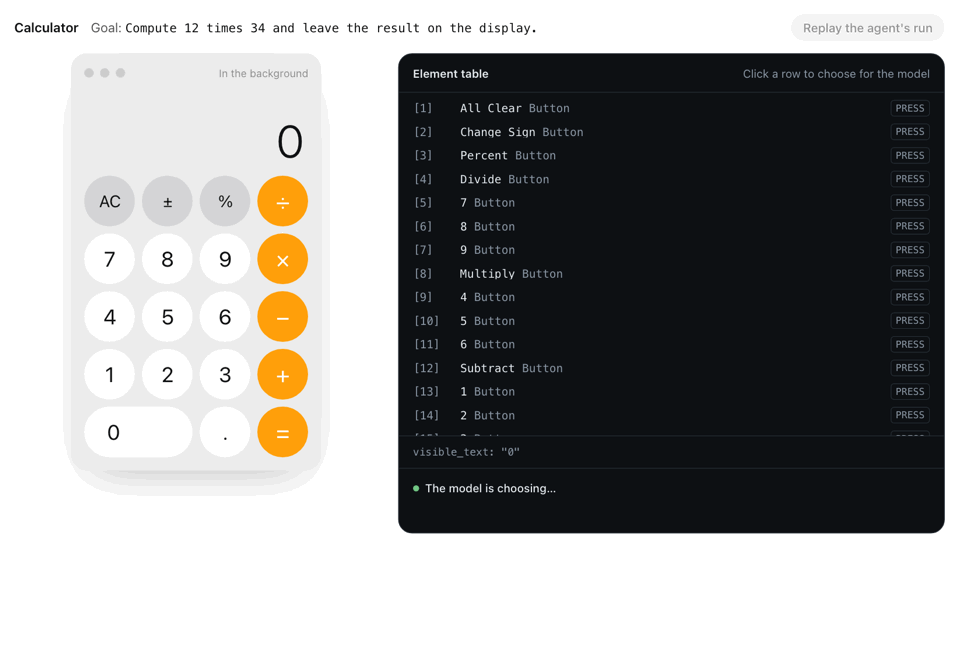

# open-computer-use ⌘

A macOS agent that completes tasks through the accessibility tree while you keep using another app.

<a href="https://max1874.com/open-computer-use/"></a>

Give it one app and one natural-language goal. Each observation produces a numbered table of the controls the app actually exposes. One model request chooses an operation, its observed target, the text to enter and the risk rating. The native bridge executes once, then reads the app again.

**Acceptance means the requested result is observed in the app and the run never takes foreground focus.** A model saying `DONE`, an API success or an unchanged frontmost PID at two sample points does not establish that.

## Run

Requires macOS, Python 3.11+, Swift and Accessibility permission for the terminal or app launching the bridge. No Screen Recording permission is used.

```sh
uv sync
scripts/build.sh
uv run --env-file .env open-computer-use --no-open
```

Open the inspector at `http://127.0.0.1:8767`. It shows the observed element table, pending decision, risk and executed history. The server binds to loopback and requires its startup token for changes.

For a command-line task:

```sh
uv run --env-file .env python examples/run.py \
  --app TextEdit --goal 'Replace the document text with a haiku about rain.'
```

Configure an OpenAI-compatible decision backend in the ignored `.env`:

```dotenv
DECISION_BASE_URL=https://api.deepseek.com/v1
DECISION_MODEL=deepseek-flash
DECISION_API_KEY=your-key
```

The optional Jev backend answers structured choice heads instead of writing JSON. Set `JEV_API_KEY`, optionally `JEV_BASE_URL` and `JEV_MODEL`. Jev cannot generate field values; `TEXT_MODEL_API_KEY`, `TEXT_MODEL_BASE_URL` and `TEXT_MODEL` configure that helper, falling back to the decision backend settings. The product reads only user-configured environment variables.

The chat backend supports JSON schema and JSON object responses. `DECISION_RESPONSE_FORMAT=json_schema` or `json_object` overrides provider detection; `DECISION_REASONING=default` keeps the provider's reasoning behavior. No token logprobs are requested.

## Python

```python
from open_computer_use import Agent

sentence = "A small task, completed in the background."

def reached(page):
    return any(e.get("value") == sentence for e in page["elements"])

with Agent("TextEdit", f"Replace the document with exactly '{sentence}'.", verify=reached) as agent:
    for state in agent.run():
        print(state["status"])
    print(agent.state["verified"])
```

`verify` receives the final observation: `True` confirms the goal, `False` rejects `DONE`, and `None` means the result could not be judged. Without it, `DONE` is the model's claim.

Consequential operations are held at `risk >= 0.5`. Inspect the decision before calling `agent.approve_pending()`, or supply an `approve(decision)` callback. The rating shares the decision request; it is the same model's judgment, not an independent safety reviewer.

## Background operations

`PRESS`, `TYPE_TEXT`, `PASTE_TEXT`, `SELECT_TEXT`, `KEY_CHORD`, `SELECT`, `CLICK`, `MENU`, `SCROLL_UP`, `SCROLL_DOWN`, `PRESS_RETURN`, `PRESS_ESCAPE`, `WAIT`, `DONE`, `BLOCKED`.

- `PRESS` uses `AXPress`; menu-opening popup and menu-button presses are withheld because they can activate an inactive app.
- `TYPE_TEXT` replaces a field. `PASTE_TEXT` inserts at its selection; `SELECT_TEXT` uses UTF-16 offsets. Editing keys are whitelisted and sent to the target process. Field focus is internal to that app; the bridge never activates it.
- File-name labels identified by `AXFilename` offer selection, never field editing or renaming. Other editable table cells retain their editing capabilities.
- `CLICK` means native row selection where the observed app supports it. It never falls back to a mouse click. This has navigated System Settings sidebar rows without moving the pointer or taking focus; it does not open an arbitrary Finder file.
- `SCROLL_UP` and `SCROLL_DOWN` choose an observed scroll area, such as a sidebar or document, and press its native vertical scroll bar’s page control. Process identity, the captured area and live capability guard delivery.
- Already-open menus can be observed. Closed menu-bar commands are offered only when the app is already active; the bridge never raises it to validate a menu. App-dependent menu titles can be stale.
- Unicode insertion prefers `AXSelectedText`, with a temporary clipboard fallback when needed. The clipboard is restored only if another app has not changed it during the operation.

There is one native executor. Activation flags, Codex-host execution, mouse input, dragging, screenshots and visual fallback have been removed. A canvas without usable accessibility controls is outside scope; it cannot be made a successful background task by taking the screen.

Native APIs can still cause app-specific side effects. `took_focus` records observed endpoint changes only. Full-run acceptance independently listens for macOS application-activation events, including a transient activation followed by a return to the original app. A run that changes the requested value but steals focus fails acceptance. Bringing the previous app back does not undo that failure.

## Delivery and identity

Every result and bridge exception carries `disposition`:

| Delivery | Evidence | Retry |
| --- | --- | --- |
| `not_delivered` | Refused before input | `safe` |
| `delivery_uncertain` | Input may have arrived; reliable reply missing | `unsafe` |
| `delivered_unverified` | Input sent; outcome unconfirmed | `unsafe` |
| `delivered_verified` | Post-action value or checkbox-state read-back matched | `unsafe` |

The agent consumes each decision once and records execution before reading its result. It never replays a mutation. Unknown delivery stops the run with its history intact. Verified delivery is separate from completing the whole task.

Targets are references from one observation, bound to the process PID and start time. Their role, name and optional native identifier must be unique across the captured surface, including unpublished nodes. An incomplete or ambiguous identity is not executable. A fresh census re-identifies the target before input; a changed child path alone cannot select the wrong control.

AX metadata is batched per traversal. Read and write deadlines are separate. A broken transport discards the helper; the next request starts a new one without replaying the old input. Permission probes run in a fresh process.

Secure fields are classified before value reads; their values and descendants are omitted, and generated input is removed from public decisions and history. This does not scrub a secret the caller explicitly places in the goal.

## Limits and verification

One app per run, including its accessible windows and open menus. Publication budgets and identity census limits are separate; incomplete observations are explicit. A run stops at 40 operations, 80 decisions, three consecutive unchanged operations, or before delivering the same action a third time on the same observed state. WAIT is exempt from repeat stopping. Existing history supplies the count; a stop is blocked, never task success. Observed state can hide real progress, and changing or unobserved state can evade this heuristic. Model task success varies independently of reliable execution.

`examples/calculator.py` and `examples/textedit.py` read their intended results back from the app. An endpoint sample showing the app inactive is not proof it stayed inactive throughout. Focus acceptance requires the independent event record over the same task interval.

[The background acceptance runner](evals/README.md) retains the 16 legacy task definitions, reads real app results independently and requires a complete activation-event record through cleanup. It preserves already-running user apps and records unavailable cases explicitly; historical scores are not current results.

`scripts/mock_model.py` is a loopback stand-in for exercising transport and execution without paid model calls. It proves no model intelligence. Unit and source-contract tests run in the existing CI, together with the Swift build; they do not replace real background task acceptance.

## Read the implementation

| File | Responsibility |
| --- | --- |
| `axbridge.swift` | Native observation, identity and guarded background execution |
| `desktop.py` | Long-lived bridge, delivery failures and settle policy |
| `actions.py` | Observed action table and answer schema |
| `model.py` | Decision backends and field-value helper |
| `agent.py` | Prediction, risk approval, once-only execution and history |
| `demo.py` | Local inspector |

Inspired by [browser-use/jev-ultrafast](https://github.com/browser-use/jev-ultrafast). See [design](docs/design.md) and [remaining boundaries](todo.md).
